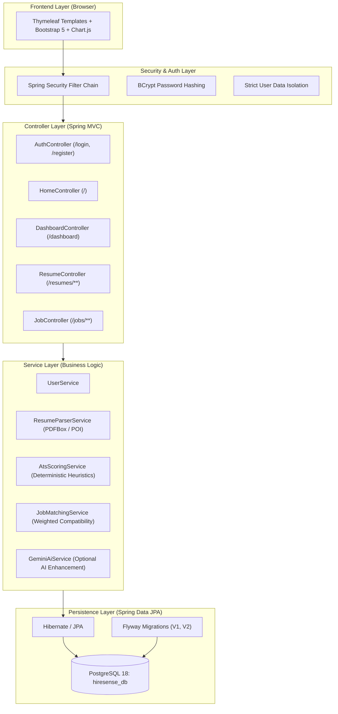
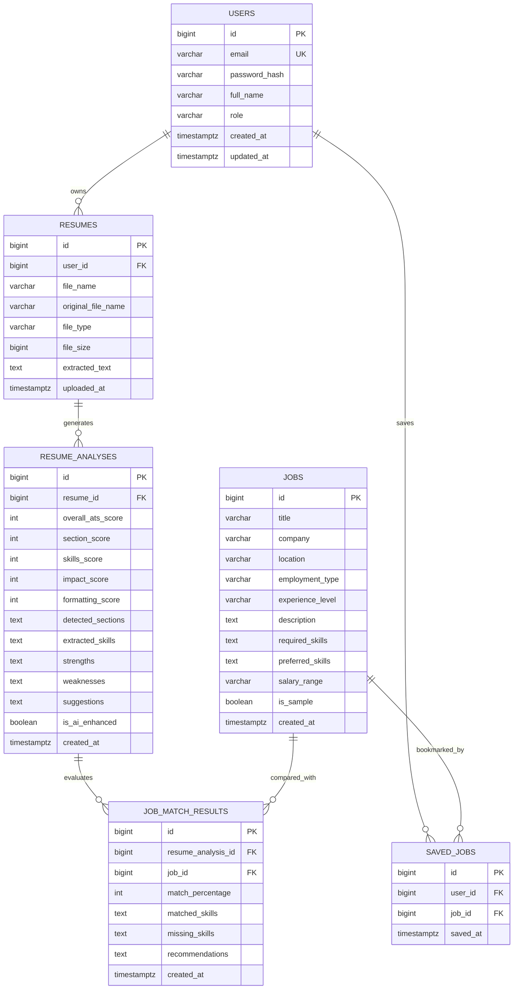

# HireSense AI — Resume Analyzer & Job Matcher

[](https://www.oracle.com/java/)
[](https://spring.io/projects/spring-boot)
[](https://www.postgresql.org/)
[](https://spring.io/projects/spring-security)
[](LICENSE)

HireSense AI is a full-stack Java Spring Boot web application designed to help students, graduates, and software engineers optimize their resumes and discover job opportunities. It extracts resume text using Apache PDFBox (PDF) and Apache POI (DOCX), computes explainable ATS-style diagnostic scores, categorizes skills across a structured technical taxonomy, and evaluates compatibility against PostgreSQL-persisted jobs.

---

## Architecture Overview



---

## Entity-Relationship (ER) Diagram



---

## Key Features

1. **Modern Landing Page**: HireSense AI branded hero section, feature cards, 3-step workflow explanation, live metric previews, and clear CTAs.
2. **Session-Based Authentication**: Registration with input validation, duplicate email prevention, BCrypt password hashing (strength 12), and secure session logout with `JSESSIONID` cookie invalidation.
3. **Strict User Data Isolation**: Every resume, analysis, and bookmark is filtered by the authenticated user's credentials in Spring Data JPA queries (`findByIdAndUser`). User IDs from client requests are never trusted.
4. **Multi-Format Resume Parser**: Ingests `.pdf` and `.docx` files using Apache PDFBox 3.x and Apache POI 5.x. Gracefully rejects password-protected files, empty documents, or unscannable images.
5. **Deterministic ATS Scoring Algorithm**:
   - **Section Completeness (25 pts)**: Contact info, Summary, Experience, Education, Skills, Projects.
   - **Skills Taxonomy (35 pts)**: Categorized across Languages, Frameworks, Databases, Cloud/DevOps, Tools, and Soft Skills.
   - **Impact & Action Verbs (25 pts)**: Strong action verbs (spearheaded, architected, engineered) and quantified metrics (%, $, numbers).
   - **Formatting & Word Count (15 pts)**: Length heuristics and structured bullet parsing.
   - **Transparent Feedback**: Strengths, weaknesses, prioritized suggestions, and official ATS estimate disclaimers.
6. **Job Catalog & Match Matrix**:
   - Filter jobs by keyword, location, employment type (Full-time, Internship, Remote), and experience level.
   - Transparent skill overlap calculation with green badges for matched skills and amber badges for missing requirements.
   - 10+ pre-seeded sample tech roles (`is_sample = true`).
   - One-click bookmarking into Saved Jobs.
7. **Personalized Dashboard**:
   - Live metrics: Total Resumes, Latest ATS Score, Saved Jobs, Evaluated Matches.
   - Visual ATS Score circle gauge with color-coded grading.
   - Chart.js doughnut chart breaking down technical skills by domain.
   - Friendly empty states for first-time candidates.
8. **Optional Google Gemini AI Enhancement**:
   - Core analyzer runs 100% deterministically without external keys.
   - If `GEMINI_API_KEY` is provided, enhances suggestions with executive advisory feedback.
   - Automatic fallback to deterministic logic on network timeout or missing credentials.

---

## Technology Stack

- **Backend**: Java 21+, Spring Boot 3.3.5
- **Security**: Spring Security 6, BCrypt
- **Persistence**: Spring Data JPA, Hibernate ORM, Flyway Migrations
- **Database**: PostgreSQL 18.6
- **Frontend**: Spring MVC, Thymeleaf, Bootstrap 5.3.3, Bootstrap Icons, Chart.js
- **Document Processing**: Apache PDFBox 3.0.3, Apache POI 5.3.0
- **Testing**: JUnit 5, Mockito, Spring Boot Test, H2 In-Memory DB

---

## Prerequisites

- **Java Development Kit (JDK)**: JDK 21 or later (`java -version`).
- **PostgreSQL**: PostgreSQL 14+ installed and running on port 5432 (`localhost:5432`).
- **Build Tool**: Apache Maven (or use bundled `./mvnw.cmd` wrapper).

---

## Local Setup & Configuration

### 1. Database Creation
Ensure your PostgreSQL server is running and create the `hiresense_db` database:
```powershell
# Open PostgreSQL shell (psql)
& "C:\Program Files\PostgreSQL\18\bin\psql.exe" -U postgres -h localhost -p 5432 -c "CREATE DATABASE hiresense_db;"
```

### 2. Environment Variables Configuration
In PowerShell, set your database credentials (or copy `.env.example` to `.env`):
```powershell
$env:DB_URL = "jdbc:postgresql://localhost:5432/hiresense_db"
$env:DB_USERNAME = "postgres"
$env:DB_PASSWORD = "your_postgres_password_here"

# Optional: Set Gemini API key for AI advisory suggestions
$env:GEMINI_API_KEY = ""
```

---

## Running the Application

Start the application with Maven:
```powershell
# Using the bundled Maven Wrapper
.\mvnw.cmd spring-boot:run

# Or using installed Apache Maven
mvn spring-boot:run
```

Once started, open your web browser and navigate to:
```text
http://localhost:8080
```

Flyway will automatically apply:
- `V1__init_schema.sql`: creates tables and performance indexes.
- `V2__seed_sample_jobs.sql`: inserts 10 sample roles for immediate testing.

---

## Running Automated Tests

Run the full automated test suite (13 unit and integration tests covering registration, login, data isolation, ATS parsing, and job matching):
```powershell
.\mvnw.cmd clean test
```

---

## Project Structure

```text
D:\Projects\hiresense-ai\
├── pom.xml
├── .gitignore
├── .env.example
├── README.md
├── mvnw / mvnw.cmd
└── src/
    ├── main/
    │   ├── java/com/hiresense/
    │   │   ├── HireSenseApplication.java
    │   │   ├── config/ (SecurityConfig, PasswordEncoderConfig)
    │   │   ├── controller/ (HomeController, AuthController, DashboardController, ResumeController, JobController, CustomErrorController)
    │   │   ├── dto/ (UserRegistrationDto, AtsScoreBreakdownDto, JobMatchDto, JobFilterDto, DashboardSummaryDto)
    │   │   ├── entity/ (User, Resume, ResumeAnalysis, Job, SavedJob, JobMatchResult)
    │   │   ├── repository/ (UserRepository, ResumeRepository, JobRepository, SavedJobRepository, ...)
    │   │   └── service/ (UserService, ResumeParserService, AtsScoringService, JobMatchingService, GeminiAiService)
    │   └── resources/
    │       ├── application.yml
    │       ├── db/migration/ (V1__init_schema.sql, V2__seed_sample_jobs.sql)
    │       ├── static/ (css/custom.css)
    │       └── templates/ (layout/, auth/, dashboard/, resume/, jobs/, error/)
    └── test/
        ├── java/com/hiresense/ (AuthControllerTest, UserDataIsolationTest, AtsScoringServiceTest, ...)
        └── resources/ (application-test.yml)
```

---

## Git Commit & GitHub Publishing Procedure

To push this project to your GitHub account:

```powershell
# 1. Review status (ensuring .env and uploads are ignored)
git status

# 2. Add all source files
git add .

# 3. Create initial commit
git commit -m "feat: initial commit of HireSense AI complete full-stack application"

# 4. Link your GitHub remote repository (replace with your repo URL)
git remote add origin https://github.com/your-username/hiresense-ai.git

# 5. Push to GitHub main branch
git branch -M main
git push -u origin main
```
